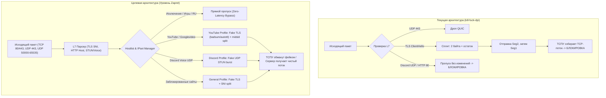

# Технический план: Доработка KILL F#CK DPI до уровня возможностей zapret (winws)

## Описание проблемы и цели

Проект `kill-fuck-dpi` задуман как автономная, легковесная C++ замена `zapret` и `winws` на базе WinDivert. Однако в реальных условиях на сетях российских провайдеров (Ростелеком, МТС, Мегафон, Билайн, Дом.ру и др.) утилита **не обходит блокировки YouTube и Discord**, в то время как zapret с этим успешно справляется.

### Фундаментальный анализ: почему текущий код не работает как zapret

#### 1. ТСПУ выполняет сборку TCP-потока (TCP Reassembly with Sliding Window)
- **Что делает текущий код:** Режет ClientHello на 2 сегмента по жесткому смещению `split_pos = 2` (первые 2 байта `16 03` и весь остаток), и отсылает сначала второй сегмент, затем первый (`disorder`).
- **Почему это не работает:** Примитивный `disorder` работал 3-5 лет назад против старых DPI без отслеживания состояния. Современные узлы ТСПУ (2024–2026) имеют буфер рекомбинации TCP (reordering queue). Получив `seg2` с `Seq = N + 2` и следом `seg1` с `Seq = N`, ТСПУ буферизирует их, мгновенно склеивает поток, парсит имя хоста (`*.googlevideo.com` или `discord.com`) и глушит сессию (RST-пакетом или молчаливым дропом).
- **Как это решает zapret:** Zapret использует техники **Fooling**:
  - `fake + badsum`: отправляет перед настоящим пакетом фейковый ClientHello с намеренно испорченной контрольной суммой TCP. ТСПУ (работающий в режиме быстрого транзита с аппаратным offload) не сверяет checksum и «заглатывает» фейк, помечая сессию разрешенной. Конечный сервер (Google/Discord) проверяет контрольную сумму стеком ядра Linux/FreeBSD и отбрасывает фейк.
  - `autottl / ttl`: фейковый пакет отправляется с малым TTL (5–8 хопов), которого хватает, чтобы долететь до ТСПУ у провайдера, но не хватает, чтобы долететь до целевого сервера в Европе/США.
  - `midsld`: разделение пакета не на 2 байта, а ровно пополам внутри домена второго уровня (например, `you` + `tube.com` или `goog` + `levideo.com`), что ломает строковые эвристики поиска домена в ТСПУ.

#### 2. Discord Voice (UDP 50000–65535) полностью проигнорирован
- **Что делает текущий код:** Перехватывает UDP только на порту 443 для сброса QUIC (`drop_quic`). В коде и README ошибочно заявлено, что голосовые порты Discord "не нужно трогать".
- **Почему это не работает:** В РФ ТСПУ блокирует голосовые каналы Discord именно по сигнатурам UDP (WebRTC/STUN) на портах 50000–65535. Без перехвата этих портов голосовой чат Discord никогда не выйдет из состояния «Подключение к RTC» / «Маршрут не найден».
- **Как это решает zapret:** Zapret перехватывает диапазон UDP 50000–65535 и отправляет фейковый пакет для открытия UDP-сессии в таблице трансляции ТСПУ.

#### 3. Папка `lists/` существует «вхолостую» (нет чтения списков и нет парсера SNI)
- В проекте присутствуют файлы `list-google.txt`, `list-general.txt`, `list-gaming.txt`, `ipset-gaming-eu.txt`, но в коде C++ **нет ни единой строчки**, читающей их.
- Парсер `ProtocolParser` не умеет извлекать домен (SNI) из ClientHello.
- В результате текущий код пытается десинхронизировать вообще весь исходящий HTTPS трафик (включая банковские приложения, Госуслуги, VK, игры), что вызывает сбои на чувствительных серверах, вместо точечного обхода только заблокированных ресурсов.

#### 4. Полный пропуск трафика HTTP (порт 80)
- `DesyncEngine::ProcessTcp` содержит условие `if (parsed.l7 != L7Protocol::TLS_ClientHello) return true;`.
- Трафик HTTP (порт 80) отправляется напрямую без изменений. Незашифрованные сайты не разблокируются.

---

## Архитектурная схема: До и После



---

## Требуется согласование с пользователем

> [!IMPORTANT]
> **Принципиальный выбор архитектурного пути:**
>
> **Путь 1 (Рекомендуемый — 100% C++ Standalone):**
> Реализовать все недостающие алгоритмы zapret внутри нашего собственного C++17 бинарника:
> - Написать полноценный парсер TLS SNI (RFC 6066) и вычисление смещения `midsld`.
> - Добавить генератор фейковых пакетов (`fake TLS ClientHello`, `fake UDP STUN`) с поддержкой `badsum` (обман ТСПУ битой контрольной суммой без NDIS пересчета) и `autottl`.
> - Подключить чтение списков из `lists/` (`HostlistManager`).
> - Добавить перехват и обход Discord Voice UDP (50000–65535).
> - Добавить готовые профили обхода в `config.ini` под популярных операторов.
>
> **Путь 2 (Интеграция winws в качестве бэкенда):**
> Переделать проект в компактный лаунчер/обертку с системной службой, GUI и автоочисткой вокруг оригинального бинарника `winws.exe`.

> [!TIP]
> Мы ориентируемся на **Путь 1**, так как главная ценность текущего проекта — независимость от внешних бинарников и чистый C++ код.

---

## Предлагаемые изменения (Детальный план реализации Пути 1)

### 1. Подсистема парсинга протоколов L7 (`ProtocolParser`)

#### [MODIFY] [include/ProtocolParser.hpp](file:///C:/Users/bomzh/Desktop/kill-fuck-dpi-main/include/ProtocolParser.hpp)
#### [MODIFY] [src/ProtocolParser.cpp](file:///C:/Users/bomzh/Desktop/kill-fuck-dpi-main/src/ProtocolParser.cpp)

Расширение структуры `ParsedPacket`:
```cpp
struct ParsedPacket {
    // Существующие поля...
    IpVersion ip_ver{IpVersion::Unknown};
    TransportProtocol transport{TransportProtocol::Unknown};
    L7Protocol l7{L7Protocol::Unknown};
    
    // Новые поля для точечного обхода:
    std::string hostname;        // Извлеченный SNI или HTTP Host
    size_t sni_offset{0};        // Смещение начала имени SNI от начала полезной нагрузки
    size_t sni_length{0};        // Длина имени хоста в байтах
    size_t midsld_offset{0};     // Смещение середины домена 2-го уровня (для split midsld)
    bool is_discord_voice{false};// Признак голосового UDP пакета Discord
};
```

Реализация алгоритма извлечения SNI:
1. Валидация TLS Record Layer (`0x16`, `0x03`, версия `0x01..0x03`).
2. Пропуск заголовка ClientHello (Session ID, Cipher Suites, Compression Methods).
3. Итерация по TLS Extensions: поиск Extension Type `0x0000` (Server Name).
4. Чтение Server Name List -> Server Name (Type `0x00`).
5. Вычисление `midsld_offset`: для домена `rr1---sn-xxx.googlevideo.com` находим Second-Level Domain (`googlevideo`), вычисляем середину (`goog` + `levideo`) и сохраняем абсолютное смещение в пакете.

---

### 2. Подсистема списков хостов и маршрутизации (`HostlistManager`)

#### [NEW] [include/HostlistManager.hpp](file:///C:/Users/bomzh/Desktop/kill-fuck-dpi-main/include/HostlistManager.hpp)
#### [NEW] [src/HostlistManager.cpp](file:///C:/Users/bomzh/Desktop/kill-fuck-dpi-main/src/HostlistManager.cpp)

- Класс `HostlistManager`:
  - Загружает файлы: `lists/list-google.txt`, `lists/list-general.txt`, `lists/list-gaming.txt`, `lists/list-exclude.txt`, а также пользовательские `*-user.txt`.
  - Эффективный поиск по суффиксу домена (например, совпадение `*.googlevideo.com` с правилом `googlevideo.com`).
  - Метод `MatchProfile(const std::string& host, uint16_t port, TransportProtocol proto)`:
    - Возвращает назначенный профиль: `ProfileType::YouTube`, `ProfileType::Discord`, `ProfileType::GeneralBlocked`, `ProfileType::DirectBypass` (для игр и белых списков).

---

### 3. Движок десинхронизации (`DesyncEngine`)

#### [MODIFY] [include/DesyncEngine.hpp](file:///C:/Users/bomzh/Desktop/kill-fuck-dpi-main/include/DesyncEngine.hpp)
#### [MODIFY] [src/DesyncEngine.cpp](file:///C:/Users/bomzh/Desktop/kill-fuck-dpi-main/src/DesyncEngine.cpp)

Внедрение техник zapret:

1. **Генерация Fake TLS ClientHello:**
   - Предопределенный минимальный валидный TLS 1.3 ClientHello (домен `iana.org` или `google.com`).
   - Клонирование IP/TCP заголовков оригинального соединения (те же IP, те же порты, тот же `SeqNum`).

2. **Реализация Fooling `BadSum`:**
   - Формирование фейкового пакета.
   - Запись намеренно искаженной контрольной суммы: `tcp_hdr->Checksum = 0xDEAD;`.
   - **Критический нюанс WinDivert:** Чтобы сетевая карта Windows (NDIS Hardware Checksum Offload) не исправила контрольную сумму на валидную, флаг `addr.TCPChecksum` сбрасывается в `0`! Пакет уходит в сеть с поврежденной суммой.

3. **Реализация Fooling `TTL / AutoTTL`:**
   - У фейкового пакета `ip_hdr->TTL = fake_ttl;` (по умолчанию 6–8 для IPv4, `HopLimit` для IPv6).
   - Пакет уничтожается маршрутизаторами за пределами РФ, не доходя до целевого сервера.

4. **Интеллектуальный Split (`midsld` и `sni`):**
   - Если профиль требует сплита по SNI: разделение производится точно по `parsed.midsld_offset` или `parsed.sni_offset`.
   - Отправка:
     - Шаг 1: Fake-пакет (с `badsum` или малым `TTL`);
     - Шаг 2: Реальный Seg1 (до середины домена);
     - Шаг 3: Реальный Seg2 (остаток ClientHello).

5. **Десинхронизация Discord Voice (UDP 50000–65535):**
   - Перехват исходящих пакетов Discord Voice.
   - Инъекция перед первым пакетом голосовой сессии короткого фейкового STUN-пакета для сбивания маскирующего фильтра ТСПУ.

---

### 4. Конфигурация и WinDivert фильтр (`ConfigManager`)

#### [MODIFY] [include/ConfigManager.hpp](file:///C:/Users/bomzh/Desktop/kill-fuck-dpi-main/include/ConfigManager.hpp)
#### [MODIFY] [src/ConfigManager.cpp](file:///C:/Users/bomzh/Desktop/kill-fuck-dpi-main/src/ConfigManager.cpp)
#### [MODIFY] [config.ini](file:///C:/Users/bomzh/Desktop/kill-fuck-dpi-main/config.ini)

1. Обновление правила фильтра WinDivert для захвата Discord Voice:
   ```text
   outbound and !loopback and (
       (tcp and (tcp.DstPort == 80 or tcp.DstPort == 443) and tcp.PayloadLength > 0) or
       (udp and udp.DstPort == 443) or
       (udp and udp.DstPort >= 50000 and udp.DstPort <= 65535 and udp.PayloadLength > 0)
   ) and !(udp.DstPort >= 27000 and udp.DstPort <= 27100) and !(udp.SrcPort >= 27000 and udp.SrcPort <= 27100)
   ```
2. Новая структура `config.ini` с готовыми пресетами:
   - `[youtube]`: `strategy = fake_split2`, `split_pos = midsld`, `fooling = badsum,autottl`, `fake_ttl = 6`
   - `[discord]`: `udp_fake = true`, `tcp_fake = true`
   - `[general]`: `strategy = fake_disorder`, `split_pos = sni`, `fooling = badsum`

---

### 5. Сборка и интерфейс (`CMakeLists.txt`, `GuiManager`, `start.bat`, `verify.ps1`)

#### [MODIFY] [CMakeLists.txt](file:///C:/Users/bomzh/Desktop/kill-fuck-dpi-main/CMakeLists.txt)
- Синхронизация `CMakeLists.txt` с `build.bat` (добавление всех `.cpp` файлов и библиотек `shell32`, `comctl32`, `user32`, `gdi32`).

#### [MODIFY] [src/GuiManager.cpp](file:///C:/Users/bomzh/Desktop/kill-fuck-dpi-main/src/GuiManager.cpp)
- Отображение текущего активного пресета в GUI и трее.
- Возможность переключения пресетов (например, "Стандартный", "Агрессивный (badsum+autottl)", "Discord-фокус") прямо из трея.

#### [MODIFY] [verify.ps1](file:///C:/Users/bomzh/Desktop/kill-fuck-dpi-main/verify.ps1)
- Добавление проверки доступности YouTube 4K видеопотоков (`rr*.googlevideo.com`).
- Добавление теста UDP подключения к голосовым шлюзам Discord (проверка прохождения портов 50000–65535).

---

## План верификации

### 1. Автоматизированные тесты
- Чистая компиляция через `cmd /c build.bat` компилятором MSVC под x64.
- Запуск расширенного скрипта `verify.ps1`.
- Проверка сетевого перехвата в консольном режиме (`dpi_bypass.exe --console`) с выводом статистики по типам пакетов (YouTube TLS fake, Discord UDP, General split).

### 2. Ручное тестирование в реальном окружении
1. **YouTube в браузере (Chrome / Edge):**
   - Открыть тестовое видео 4K 60fps на YouTube.
   - Включить "Статистика для сисадминов" (Stats for nerds).
   - Убедиться, что буфер (Buffer Health) непрерывно растет (> 30-50 секунд), а скорость сети (Connection Speed) не ограничена дросселированием ТСПУ.
2. **Discord:**
   - Открыть десктопный клиент Discord.
   - Зайти в голосовой канал сервера. Убедиться, что статус мгновенно переходит в зеленый `RTC Connected`, пинг стабилен, голос слышно в обе стороны.
   - Проверить загрузку картинок и стримов в Discord.
3. **Заблокированные сайты:**
   - Проверить открытие Rutracker, X/Twitter, Instagram.
4. **Игровой трафик (CS2 / FACEIT / Xplay):**
   - Запустить CS2 или подключиться к серверам Xplay/FACEIT. Убедиться, что пинг остался неизменным (0 ms добавленного лага), а драйвер WinDivert не трогает порты 27000–27100.
